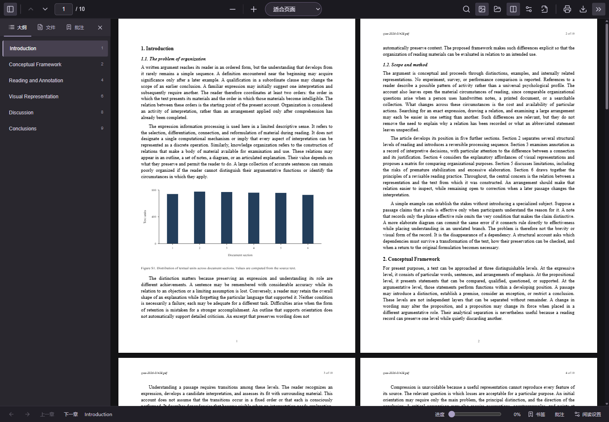
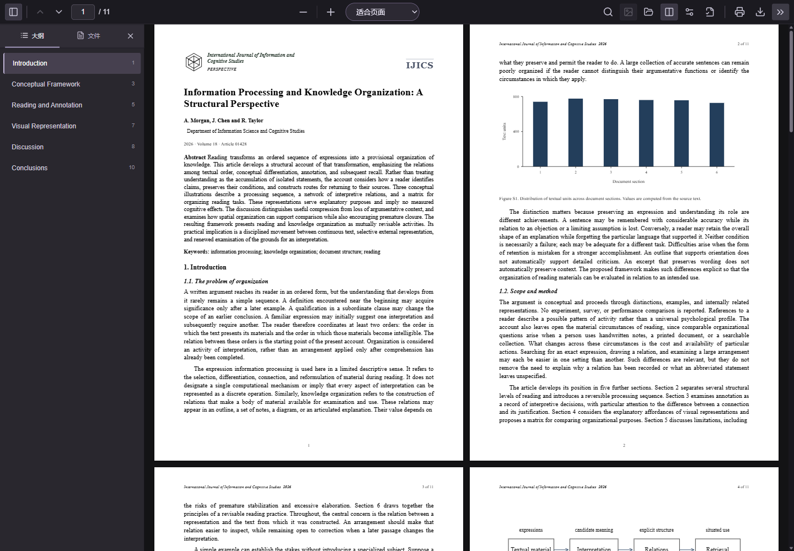

# 我爱上班 · I Love Work

[简体中文](README.md) · [English](README.en.md)

[MIT 开源许可证](LICENSE)

**表面研读论文，实际追到下一章。**

一个在本地浏览器运行的 EPUB 阅读器。保留原书正文，把阅读界面排成克制的 A4 文档；需要时按 `Q`，切换到你选好的 PDF 论文或 Word 文档。

[下载 Windows 版](https://github.com/Mossener/i-love-work/releases/latest) · [快速开始](#快速开始) · [快捷键](#快捷键) · [从源码运行](#从源码运行)



## 快速开始

### Windows x64 发布版

当前版本：**v1.1.0**。

1. 在 [Releases](https://github.com/Mossener/i-love-work/releases/latest) 下载 **Windows x64 ZIP**。
2. 完整解压到一个长期保留的文件夹，例如 `D:\Apps\ILoveWork`。
3. 双击 **`start.vbs`**。默认浏览器会打开 [http://127.0.0.1:5173](http://127.0.0.1:5173/)，程序图标留在 Windows **右下角系统托盘**。
4. 打开或拖入一本 EPUB，开始阅读。

发布包已包含 Node.js 运行环境与构建好的页面，**不需要另装 Node.js、不需要执行 npm 命令，正常启动不会留下命令行窗口**。`start.bat` 也会转到同一个托盘启动器。请先解压完整文件夹，不要直接在 ZIP 内启动或只复制启动文件。

### 托盘操作

| 操作 | 作用 |
| --- | --- |
| 双击图标 / 右键「打开阅读器」 | 再次打开阅读页面 |
| 右键「打开启动日志」 | 查看启动问题 |
| 右键「退出」 | 关闭托盘及它启动的本地服务 |

关闭浏览器标签页后，服务仍在托盘运行；重复启动会打开已有实例。找不到图标时，可查看系统托盘的隐藏图标区域。若复用了手动启动的本项目开发服务，退出托盘不会停止该服务。

启动日志保存在 `%LOCALAPPDATA%\ILoveWork\<实例目录>\`。默认端口固定为 `5173`；被其他程序占用时会提示原因，不会悄悄换端口。

## 可以做什么

| 阅读原书 | 使用遮挡文档 |
| --- | --- |
| EPUB 2 / EPUB 3，章节、脚注及尾注跳转 | 选择本地 PDF 或 Word `.docx`，也可使用内置论文 |
| 字号、行距、字体和纸白 / 暖纸 / 夜间配色 | PDF 保留原始版式，支持内置目录和页面链接 |
| 书签、划线、批注、查找和阅读进度 | PDF 文字查找及高亮；Word 标题目录和全文查找 |
| 文字锚点保存位置，改变图片或字号后回到原文 | `Q` 随时切换；鼠标移出页面可自动覆盖 |
| 本地书库、筛选、排序、每本书独立进度 | 缩放、翻页、打印或导出整份当前文档 |

### 原文和论文模板各归其位

EPUB 阅读模式保留书中正文和插图，**不插入遮挡论文的标题、摘要或关键词**。切换到覆盖模式时，展示内置论文或自选 PDF / Word。

原书插图可保留图注并点击放大。图片按钮可以隐藏 / 显示 EPUB 原始图片；Word 遮挡文档有独立的图片设置，互不影响。开关图片、调整字号或重新分页时，按正在阅读的**原文文字位置**恢复，而不是沿用可能已经改变的页码。整屏只有图片时，会定位最近的正文。

`»` 菜单中的「附加统计图与结构图」可单独控制额外图示：篇幅分布根据原书实际中文字符 / 英文单词统计，结构图根据原始章节顺序生成，并附说明。它们不代表书中的实验结果。PDF 原始版式不支持去除图片。

### 书签、批注与继续阅读

- 侧栏「大纲」定位章节和目标段落；正文中的本地链接支持章节、脚注与尾注跳转。返回按钮或 `Alt+←` 可回到引用处。
- 底部可切换上一章 / 下一章、拖动阅读进度，或返回 / 前进到先前的跳转位置。阅读百分比按当前分页计算。
- 点击「书签」记录当前位置；选中正文后点击「划线并批注」，可添加笔记并选择黄、绿、蓝、粉四种颜色。
- 侧栏「批注」支持查找、筛选、编辑和跳回原文；可导出 Markdown 笔记，或用 JSON 备份和恢复。JSON 导入只合并当前同一本 EPUB 的记录，保留本地已有的同 ID 内容。
- 侧栏「文件」支持按书名 / 作者筛选，按最近阅读、书名或添加时间排序。刷新、切换书籍后可继续上次阅读。

每本书最多保存 1000 条书签与批注；单次选文最多 12000 字符，JSON 备份文件最大 20 MiB。建议定期导出备份。

### PDF / Word 遮挡



点击工具栏「选择遮挡文档」，导入本地 **PDF 或 `.docx`**。PDF 使用自身的内置目录和链接定位目标；Word 从标题生成大纲。文档没有目录时，侧栏提供按页跳转。Word 会保留正文、表格及内嵌图片，重新排为 A4 页面。

`Ctrl+F` 可查找当前显示的书籍或遮挡文档，`Enter` / `Shift+Enter` 跳到下一项 / 上一项。**PDF 查找和高亮需要文件中存在可提取的文字；扫描图片 PDF 没有 OCR 功能。**

按 `Q` 切换到遮挡文档，再按一次回到原书；在工具栏上点击按钮后也可以直接按 `Q`。书籍和遮挡文档分别保留阅读位置。在输入框或可编辑区域输入 q 时不会切换。

默认开启「鼠标移出自动覆盖」：鼠标离开页面显示区域后进入覆盖模式；**移回不会自动恢复**，按 `Q` 返回。可在 `»` 菜单关闭。导入、编辑弹窗或拖拽文件期间暂停触发，触屏点按不会触发。

打印按钮处理整份当前文档。书籍和 Word 可通过浏览器打印窗口导出 PDF；自选 PDF 可下载原文件或打开原文件打印。缩放与双页并排适用于书籍和遮挡文档，窄屏自动使用单页。

## 快捷键

| 按键 | 功能 |
| --- | --- |
| `Q` | 书籍 / 遮挡文档切换 |
| `Ctrl+O` | 打开 EPUB |
| `Ctrl+F` / `Ctrl+K` | 查找当前文档 |
| `Enter` / `Shift+Enter` | 下一项 / 上一项查找结果 |
| `←` / `→`、`PageUp` / `PageDown` | 上一页 / 下一页 |
| `空格` / `Shift+空格` | 下一页 / 上一页 |
| `Home` / `End` | 文档开头 / 结尾 |
| `Ctrl+D` | 添加书签 |
| `Alt+←` / `Alt+→` | 返回 / 前进到跳转位置 |
| `Esc` | 关闭查找、图片预览或弹窗 |

阅读快捷键在输入框、可编辑区域或对话框中暂停，避免输入时误操作。使用浏览器版本时，macOS 对应的 `Ctrl` 组合键可使用 `⌘`；Windows 托盘发布包仅面向 Windows。

## 本地数据与隐私

书籍和遮挡文档在浏览器中解析，**不上传文件，不需要账户或 AI API key**。文档脚本不会执行；导入会清理活动内容和外部图片。PDF 解析所需的字库、字符映射等资源随程序提供。

文件保存在 IndexedDB；书签、批注、文字位置、阅读设置、图片开关等保存在浏览器本地存储。继续使用**同一浏览器配置文件和 `http://127.0.0.1:5173` 地址**，即可访问原书库和记录。改用其他浏览器、无痕窗口、`localhost` 或不同端口会进入另一份存储空间。清除站点数据会删除书库及记录，请保留原文件并导出批注备份。

标签页默认使用中性 PDF 文件名；可在「文档属性」调整文件名和论文页眉等外观信息。它们不会替换 EPUB 原文。

## 从源码运行

开发需要 **Node.js 20 或更新版本**。

```sh
git clone https://github.com/Mossener/i-love-work.git
cd i-love-work
npm install
npm run dev
```

打开 [http://127.0.0.1:5173](http://127.0.0.1:5173/)。手动开发启动需保持终端运行，按 `Ctrl+C` 停止。

```sh
npm run build     # TypeScript 检查并生成 dist/
npm run preview   # 预览生产构建
npm test          # 运行测试
```

Windows 源码目录也可使用 `start.vbs`：存在 `dist/` 和生产服务脚本时启动构建后的页面，否则使用已安装依赖中的 Vite。**源码仓库不附带 Node.js 运行环境**，只有 Windows 发布 ZIP 内置运行环境；修改源码后请重新构建 `dist/`，或使用 `npm run dev`。

## 支持范围

- 支持常见的无 DRM EPUB 2 / EPUB 3。单文件最大 **80 MiB**，解压后最大 **250 MiB**。
- 遮挡文档支持未加密 PDF 和 `.docx`，单文件最大 **80 MiB**；Word 解压后最大 **250 MiB**。旧版 `.doc` 请先另存为 `.docx`。
- EPUB 统一为文档排版，不保证还原复杂 CSS 或固定版式；Word 的复杂布局、页眉页脚和手动分页也可能与原文件不同。
- 不解密 DRM，不支持 ZIP64、分卷 ZIP、文档交互脚本、音视频或扫描 PDF 的 OCR。大型图片书可能占用较多内存。
- Windows 发布版为 x64 ZIP；其他系统可从源码运行 Web 阅读器，目前不提供 macOS 应用包或独立单文件 `.exe`。

## 项目结构

```text
src/PdfApp.tsx                 阅读界面、书库、查找与模式切换
src/lib/epub.ts                EPUB 解析、清理与资源链接
src/lib/reading-document.ts    隔离原书与论文模板
src/lib/pagination.ts          A4 测量与分页
src/lib/reading-position.ts    原文文字锚点与位置恢复
src/lib/reader-marks.ts        书签、划线、笔记与备份
src/lib/pdf-navigation.ts      PDF 目录、链接、文字查找
src/lib/cover-document.ts      PDF / Word 导入
scripts/reader-tray.ps1        Windows 托盘与服务生命周期
scripts/reader-server.mjs      发布版本地页面服务
```

仓库附有 [EPUB 示例](public/samples/paperleaf-sample.epub)，可测试章节链接、正文和插图。图标来源及授权见 [图标说明](assets/icons/NOTICE.md)。
